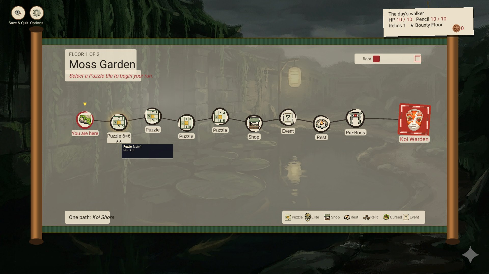
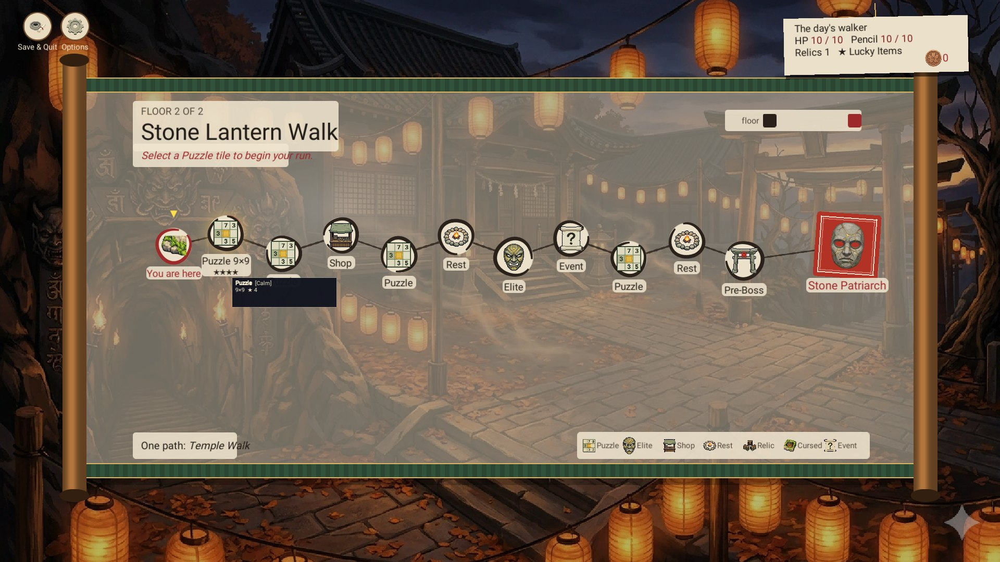

# Daily Goal System

**Version:** 0.11 | **Date:** 2026-11-03 | **Status:** implemented (the daily walk on one path over Floors 2 and 4, the stamp shop)

### Change History

| Version | Date | Status | Changes |
|---------|------|--------|---------|
| 0.11 | 2026-11-03 | implemented | The old goal panel of the main menu (unreachable since 0.3.3, GAP-110) is removed with its texts; the widget's button opens the walk's curtain on Game Modes (DAILY-GOAL-004, owner 2026-11-03). |
| 0.10 | 2026-11-02 | implemented | 0.3.1 playtest (owner, RM-219): the walk's floors are two tiles shorter, and a saved walk counts only on its own day: the path says so, the main menu's card says "continue it today", and a walk saved on an earlier day ends like an abandoned walk (DAILY-WALK-010). |
| 0.9 | 2026-10-28 | implemented | 0.3.0 playtest, owner: way B and "Read an event" (RM-216): the Daily Walk on one path over the gardens of Floors 2 and 4, one event tile per floor, the goal "Read an event on the path" in place of "Take the Risk route" (DAILY-WALK-009). The Garden Run keeps its five floors and two routes. |
| 0.8 | 2026-10-28 | review | Concept (RM-216, 0.3.0 playtest): the Daily Walk on one path and on Floors 2 and 4, the Garden Run on Floors 1, 3 and 5 (RM-113); two ways to build it and the open questions. Not built. |
| 0.7 | 2026-10-27 | review | The older sections (overview, menu, pool, evaluation, streak, ink stamps, data model, files) brought to what is built since 0.4; the stamp gallery idea replaced by the built stamp shop; how long the shop takes (69 stamps). |
| 0.6 | 2026-10-27 | review | Owner request (2026-10-27): the daily walk concept (v1.1) is merged into "The Daily Walk as a run": the why, the reward table, the owner's answers and the dropped alternatives. Its file is removed. No rule changed. |
| 0.5 | 2026-10-26 | review | The ink stamp shop built (DAILY-WALK-007, UI-STYLE-029): twelve looks on three shelves, prices from the mockup for playtesting. |
| 0.4 | 2026-10-26 | review | Owner: "Implementier die UI-Styles"; the walker gets 10 HP and 10 Pencil (2 bag slots, the class average), the pool keeps 21 goals with four replaced, and the weekly scroll stays, counted by stamps earned (owner, 2026-10-26). Built: DAILY-WALK-001 to 006 and 008, the Game Modes slip (UI-STYLE-027) and the result (UI-STYLE-028). The goals no longer count in a Garden Run, their gold, reroll and stamp rewards are gone. |
| 0.3 | 2026-10-26 | under review | The Daily Walk becomes a run of its own (the daily walk concept, merged in 0.6; owner's answers 2026-10-25, RM-122): two floors with a boss each, no class, XP to a class chosen at the end, the goals only inside the walk, ink stamps for looks, a leaderboard of the day (DAILY-WALK-001 to 008). Until it is built the goals below stay as they are. |
| 0.2 | 2026-10-07 | implemented | Status set from evidence (SPEC-CONF-022): streak and goal evaluation covered by DailyStreakTests and GameplayEffectContractTests. Daily Walk widget on the main menu as built (SPEC-CONF-027, GAP-028); skipped days reset the streak (GAP-028). |
| 0.1 | 2026-04-09 | new | Initial specification |

---

## Overview

Each day the player gets **3 daily goals**, drawn from a seeded pool, the same for every player on that date (no network
needed). Since 0.4 the goals are met only inside the **Daily Walk**, a run of two floors (section "The Daily Walk as a
run"). The goals pay class XP, all three bring an ink stamp, and a streak counts the days with all three goals met.

---

## Main Menu Placement

The Daily Walk is a curtain on Game Modes (UI-STYLE-027). Its slip shows the day, the rules, today's goals (met ones
ticked), and a side box with the streak and its XP bonus, the ink stamps (and how many this week) and the day's board.
Its buttons: Back, Stamp shop, and "Walk today's garden" ("Give … XP" while XP waits for a class, "Abandon & walk" when a
saved run would end).

The compact widget on the main menu stays (1.1, SPEC-CONF-027, GAP-028): today's goals met and the streak, and an Open
button to the walk's curtain on Game Modes (DAILY-GOAL-004; the old goal panel is removed, GAP-110).

---

## Goal Seeding

The 3 goals for a day are picked with the date as the seed:

```csharp
int seed = LocalDate.Year * 10000 + LocalDate.Month * 100 + LocalDate.Day;
var rng = new Random(seed);
```

- Goal 1: always Tier 1 (Easy)
- Goal 2: Tier 2 (Medium)
- Goal 3: Tier 2 or Tier 3 (50/50 by the day's seed)

The Discord walk posts compute the same goals (`tools/discord/walk_calendar.py`, RUN-WEEK-002); they read the pool from
`DailyGoalService.cs`, so the pool keeps 7 goals per tier.

---

## Goal Pool (21 Goals)

The pool since 0.4 (owner 2026-10-26: the old 21 with four replaced that needed Floors 3 to 5 or a class). Every goal
pays class XP by its tier (DAILY-WALK-003).

### Tier 1 · Easy

| ID | Goal | Reward |
|----|------|--------|
| `t1_any_puzzle` | Complete any puzzle | +50 XP |
| `t1_visit_rest` | Visit a Rest node | +50 XP |
| `t1_spend_gold` | Spend 50 gold in a single run | +50 XP |
| `t1_collect_item` | Collect any item | +50 XP |
| `t1_use_pencil` | Use pencil marks in a puzzle | +50 XP |
| `t1_visit_shop` | Visit the Coffee & Ice Cream cart | +50 XP |
| `t1_read_event` | Read an event on the path (owner, 2026-10-28; it replaced `t1_choose_risk`) | +50 XP |

### Tier 2 · Medium

| ID | Goal | Reward |
|----|------|--------|
| `t2_no_mistake` | Complete a puzzle with no mistakes | +100 XP |
| `t2_defeat_boss` | Defeat any boss | +100 XP |
| `t2_collect_150g` | Collect 150 gold in a single run | +100 XP |
| `t2_use_2_items` | Use 2 items in a single run | +100 XP |
| `t2_floor2` | Reach Floor 2 | +100 XP |
| `t2_accept_cursed` | Accept a Cursed node | +100 XP |
| `t2_collect_relic` | Collect a relic | +100 XP |

### Tier 3 · Hard

| ID | Goal | Reward |
|----|------|--------|
| `t3_full_hp_floor` | Complete any floor without losing HP | +200 XP |
| `t3_no_pencil_puzzle` | Complete a puzzle using zero pencil marks | +200 XP |
| `t3_finish_hp3` | Finish the walk with 3 HP or more (new 0.4) | +200 XP |
| `t3_finish_no_item` | Finish the walk without using an item (new 0.4) | +200 XP |
| `t3_finish_walk` | Finish the walk: defeat the Floor 2 boss (new 0.4) | +200 XP |
| `t3_no_mistake_boss` | Defeat a boss with no mistakes | +200 XP |
| `t3_three_perfect` | Solve three puzzles without a mistake in one walk (new 0.4) | +200 XP |

---

## Goal Evaluation

`DailyGoalService.EvaluateInRun(state, run, level, trigger)` runs after each relevant action (puzzle complete, node
entered, gold spent, boss defeated, the walk finished). It only runs in the day's scored walk: `RunDirector.DailyGoals`
is set for that walk alone (DAILY-WALK-004, DAILY-WALK-005). A met goal stays met for the day.

Rewards: no gold or reroll tokens any more (removed 0.4). The goals' XP joins the walk's XP at its end (DAILY-WALK-003).
All three goals met: +1 ink stamp (DAILY-WALK-006).

---

## Streak System

| Condition | Effect |
|-----------|--------|
| All 3 goals met on a day | The streak grows by 1 at the next day's refresh |
| A day with a goal left, or a day not played | The streak is 0 (on the first launch after a skipped day too; fixed 1.1, GAP-028; `DailyStreakTests`) |
| Streak day 3 to 6 | The walk's XP +10 % (DAILY-WALK-003) |
| Streak day 7 and on | The walk's XP +25 % |
| Every 7th day of an unbroken streak | +3 ink stamps |
| Streak 30 | +10 ink stamps, once |
| Streak 100 | +25 ink stamps, once |

---

## Ink Stamps

Ink stamps come from all three goals of a day (+1), the streak milestones above and the Monthly Walk (+1 for the
month's first finish, +2 for an S grade). Every stamp goes through `DailyGoalService.EarnStamps`, which also counts the
stamps earned in the ISO week: the 7th stamp earned in a week adds the weekly scroll, 500 XP that wait for a class like
the walk's XP (owner 2026-10-26: counted by stamps earned, spent or not).

Stamps are spent in the stamp shop (DAILY-WALK-007, UI-STYLE-029) on looks only. The twelve looks cost 69 stamps in all:
board ink 27 (indigo, cinnabar and moss 5 each, gold leaf 12), seal frames 28 (moss 6, vermilion 8, gold 14), path seals 14
(indigo 6, round sumi 8). At one stamp a day that is 69 days; with an unbroken streak and its milestones about 42 days.

---

## Data Model

`DailyGoalState` in `SaveModels.cs` (in the save file's envelope):

```csharp
[Serializable]
public sealed class DailyGoalState
{
    public string LastGoalDate;          // "yyyy-MM-dd" of the day the goals were picked
    public int[] TodayGoalIds;           // [3] indices into the pool
    public bool[] TodayGoalCompleted;    // [3]
    public int CurrentStreak;
    public string LastStreakDate;
    public int TotalInkStamps;
    public List<int> UnlockedCosmetics;  // owned looks: shelf × 10 + look
    public int PendingWalkXp;            // XP waiting for a class (walks and the weekly scroll)
    public string LastScoredWalkDate;    // the day's scored walk
    public string StampWeek;             // ISO week of StampsThisWeek
    public int StampsThisWeek;
    public int WornBoardInk, WornSealFrame, WornPathSeal;   // worn looks, 0 = the game's own
}
```

Removed in 0.4 (JsonUtility drops them from old saves): `PendingStartGold`, `PendingStartRerollTokens`,
`ClassLastPlayedIds`, `ClassLastPlayedDates`.

On profile load (`GameBootstrap.Start`, `ApplySlotChange`) `RefreshIfNewDay` settles the streak of the day before and picks
the new goals, and `InkStampShop.Apply` wears the profile's looks.

---

## Implementation Notes

| File | Role |
|------|------|
| `Run/DailyGoalService.cs` | Pool, seeding, `RefreshIfNewDay`, `EvaluateInRun`, `EarnStamps`, `WalkSeed`, `TryStartScoredWalk`, `WalkXp`, `SettleWalk` |
| `Bootstrap/GameBootstrap.cs` | The walk's launch and resume (two floors, the scored walk, the saved goals reloaded) |
| `Save/ProfileService.cs` | `SettleDailyWalk`, `GiveWaitingXp`; a walk never commits class XP or a Garden Run win |
| `Meta/InkStampShop.cs`, `UI/StampShopView.cs` | The stamp shop and its looks |
| `UI/MainMenuController.GameModes.cs`, `UI/EndScreenViewController.DailyWalk.cs`, `UI/DailyWalkGiveView.cs` | The slip, the result and giving the XP |
| `Meta/SteamLeaderboardService.Boards.cs` | The day's board |

## The Daily Walk as a run (0.3, under review)

The owner's answers (2026-10-25) turn the Daily Walk into a short run of its own. Built: DAILY-WALK-001 to 008 (table
below), the Game Modes slip (UI-STYLE-027), the result (UI-STYLE-028) and the stamp shop (UI-STYLE-029). The mockups are
in `docs/design/layout-proposals.md` 2.9.

#### Why

The daily walk concept (2026-10-25) found four reasons the Daily Walk did not bring a player back every day:

1. **The rewards belong to one run.** 20 gold or a reroll token is gone when the run ends. Now the XP stays with a class.
2. **Ink stamps buy nothing.** Now they buy looks (DAILY-WALK-007).
3. **There is no short session.** The goals sat inside a five-floor run, and the hard ones ("win a run", "reach
   Floor 4") need an evening. Now the walk is two floors.
4. **Nothing to compare.** Everyone got the same goals, but nobody saw how others did. Now there is a board of the day
   (DAILY-WALK-008).

#### Reward table

| Reward | Amount | Rule |
|---|---|---|
| Walk finished | the walk's XP ×1.5 (dawn bonus) | DAILY-WALK-003. The concept's example: about 400 XP for a walk, 600 with the bonus, one and a half levels for a class around Level 20 (365 XP to the next level). |
| Each goal met | easy +50, medium +100, hard +200 XP | DAILY-WALK-003. They replace the old 20 gold, reroll token and stamp of the goals. |
| All three goals | +1 ink stamp | DAILY-WALK-006 |
| Streak | day 3: +10 % XP; day 7: +25 %; kept while the streak holds | DAILY-WALK-003. A missed day costs the bonus, not the stamps. |
| Seventh stamp in an ISO week | 500 XP for the class the player picks | Owner, 2026-10-26: the weekly scroll stays, counted by stamps earned, spent or not (0.4). |

#### Owner's answers (2026-10-25)

1. **Length:** two floors, each with its boss (owner: "Jede Etage mit Boss", every floor with a boss).
2. **Class:** none, "to avoid that a class is still not unlocked". Everyone walks with the same HP, Pencil and bag. The
   XP goes to an unlocked class the player chooses on the result screen ("Klasse am Ende wählen").
3. **The old goals inside the Garden Run go away;** the three goals are met inside the daily walk.
4. **Ink stamps also buy looks** in a shop.
5. **A Steam leaderboard of the day now.**

Dropped alternatives (concept 1.0 and 1.1): a one-floor walk with three puzzles and no boss, one class for everyone on a
day, and the old goals kept inside the Garden Run as a second source of XP. The open build questions of the concept (the
walker's HP, Pencil and bag, the goal pool, the weekly scroll) were decided on 2026-10-26 (below).

| ID | Rule |
|----|------|
| DAILY-WALK-001 | The daily walk is a run of two floors, each ending with its boss, on the day's seed: the same boards, rules and offers for every player that day. |
| DAILY-WALK-002 | No class: everyone walks as the same neutral walker (no passive, no class relics), so a class not unlocked yet is no disadvantage. |
| DAILY-WALK-003 | XP: the walk's XP ×1.5 (dawn bonus), plus each goal met (easy +50, medium +100, hard +200), the sum raised by the streak bonus (+10 % from day 3, +25 % from day 7). The player gives it to an unlocked class on the result screen; until then it waits. |
| DAILY-WALK-004 | The three goals of the day are met only inside the daily walk and fit its length; the Garden Run no longer checks them. |
| DAILY-WALK-005 | One scored walk a day. Walking it again is allowed and pays nothing. |
| DAILY-WALK-006 | All three goals met: +1 ink stamp. |
| DAILY-WALK-007 | Ink stamps buy looks in a stamp shop (board ink, class seal frames, path seals); looks only, no balance. |
| DAILY-WALK-008 | The walk's run score goes to a Steam leaderboard of the day; the result shows the place and the friends. |
| DAILY-WALK-009 | The walk goes on **one path** over the gardens of **Floors 2 and 4** (Moss Garden, Stone Lantern Walk) with their boards, rules and bosses; each floor has one event tile; the player counts the walk's floors 1 and 2. A walk saved before keeps its Floors 1 and 2 and both routes. |
| DAILY-WALK-010 | The walk's floors are two tiles shorter than the Garden Run's. Save & Quit keeps the walk until midnight: the path says so, the main menu's run card reads "Daily Walk · Floor 1 of 2 · continue it today", and a walk saved on an earlier day ends like an abandoned walk (its boards' XP goes to the XP waiting for a class; the earlier day's goals do not count any more). |

Owner's decisions (2026-10-26): the walker starts with 10 HP, 10 Pencil and 2 bag slots (the class average, the numbers
of `ClassId` 0 in `ClassCatalog`) and one starting relic from the day's seed. The pool keeps 21 goals, 7 per tier, so
the Discord posts keep working (`walk_calendar.py` reads the C# lines); four that need floors 3 to 5 or a class are
replaced: "Finish the walk (defeat the Floor 2 boss)", "Finish the walk with 3 HP or more", "Finish the walk without
using an item", "Solve three puzzles without a mistake in one walk". The weekly scroll stays: the seventh ink stamp
earned in an ISO week (spent or not) adds 500 XP to the XP waiting for a class.

| ID | As built |
|----|----------|
| DAILY-WALK-001 | "Walk today's garden" on the Game Modes slip starts a Garden Run with `DailyWalk` set, `TotalFloors` 2 and the day's seed (`DailyGoalService.WalkSeed`, FNV-1a of the date). A saved run is abandoned first ("Abandon & walk"). |
| DAILY-WALK-002 | The walker is `ClassId` 0: the catalog's base numbers, no passive, no class relics; the run's screens name it "The day's walker". |
| DAILY-WALK-003 | At the end `ProfileService.SettleDailyWalk` adds the XP to `DailyGoalState.PendingWalkXp`; the result (UI-STYLE-028) gives it to an unlocked class (`GiveWaitingXp`). Left there, it waits, and the Daily Walk's way in reads "Give … XP" until it is given. A daily walk is never a Garden Run win (no Harmony unlock, no class garden entry). |
| DAILY-WALK-004 | `RunDirector.DailyGoals` is set only for the day's scored walk, so a Garden Run no longer meets the goals. |
| DAILY-WALK-005 | `DailyGoalState.LastScoredWalkDate`: a second walk the same day has no goals, no XP sum and no board entry. |
| DAILY-WALK-006 | All three goals: +1 ink stamp (`EarnStamps`); the streak milestones and the Monthly Walk's stamps go through it too. |
| DAILY-WALK-007 | `InkStampShop` (Meta): board ink (sumi black, indigo 5, cinnabar 5, moss 5, gold leaf 12), class seal frames on Select Class (ink, moss 6, vermilion 8, gold 14), path seals on the run end (vermilion, indigo 6, round sumi 8); the first of each shelf is the game's own and free. Owned looks in `UnlockedCosmetics` (shelf × 10 + look), worn ones in `WornBoardInk`, `WornSealFrame`, `WornPathSeal`; the profile's looks are worn when it loads. Under indigo ink the player's own digits turn sumi black, so given and placed digits never look alike. The shop opens from the Daily Walk's slip ("Stamp shop"). |
| DAILY-WALK-008 | `SteamLeaderboardService.SubmitToBoard` uploads the run score to "DailyWalk_yyyy-MM-dd" (kept best) and reads the top three, the place and the place among friends; without Steam the board says so. |
| DAILY-WALK-009 | `RunDirector.BeginDailyWalkPath` sets `RunState.DailyWalkPath` and starts on floor index 1; `AdvanceToNextFloor` steps by `FloorStep` (2); `RunGraphService.BuildFloorGraph(..., onePath)` builds the Calm row alone, no cross-link, with `EnsureEvent`; `RunState.WalkFloor` and `OnLastFloor` give the walk's own count to every floor text, the end of the walk and the save check. The goal `t1_read_event` is met in `ResolveCurrentEventChoice`. |
| DAILY-WALK-010 | `RunGraphService.BuildFloorGraph(..., onePath)` takes two tiles off the Calm row from graph version 3 (a walk saved before keeps its length); `SaveFileService.IsWalkOfAnotherDay` compares the saved seed with `DailyGoalService.WalkSeed(today)`; `RunResumeService.EndWalkOfAnotherDay` (called by the main menu through `GameBootstrap.EndWalkOfAnotherDay`) abandons such a walk and the status line says so (`MainMenu.WalkEnded`); the path's line `InRun.Path.OnePath` and the run card `MainMenu.WalkLine` tell the player. Tests: `DailyWalkRunTests.TheWalksFloors_AreTwoTilesShorter`, `ASavedWalk_ContinuesTheSameDay_AndEndsOnALaterDay`. |

A walk counts as a run for the class-unlock counters (bosses defeated, gold, items, relics), the run count and the boss
achievements, never as a win (no Harmony unlock, no win achievements). Saves from before 0.4: pending start gold and
reroll tokens from the old goal rewards are dropped, and a goal saved under a replaced index changes once.

The Discord walk posts (RUN-WEEK-002) list the new goals and their XP on their own; their wording ("the same for
everyone who plays today") still says nothing about the walk and is the owner's to change.

---

## One path and floors of its own (concept 0.8, built 0.9, RM-216)

The owner's request (0.3.0 playtest): the Daily Walk on **one path** with **other garden themes than the main game**,
taking up the idea of building the main game on Floors 1, 3 and 5 (RM-113, GameDesignSpec §14) and giving Floors 2 and
4 to the Daily Walk.

### Today

| Floor | Theme | Boss | Boards | Rules on the floor |
|---|---|---|---|---|
| 1 | Bamboo Courtyard | Grove Spirit | 5×5–6×6 | 0 |
| 2 | Moss Garden | Koi Warden | 6×6–7×7 | 1 |
| 3 | Koi Terrace | Shrine Oni | 7×7–8×8 | 1 |
| 4 | Stone Lantern Walk | Stone Patriarch | 8×8–9×9 | 1 |
| 5 | Shrine Summit | Demon Mask | 9×9 | 2 |

The Garden Run walks all five on two routes (Calm and Risk, joined by cross-links); the Daily Walk walks Floors 1 and 2
of the same garden, on both routes.

### The proposal

| | Garden Run | Daily Walk |
|---|---|---|
| Floors | 1 Bamboo Courtyard, 3 Koi Terrace, 5 Shrine Summit (three floors, three bosses) | 2 Moss Garden, 4 Stone Lantern Walk (two floors, two bosses) |
| Path | Calm and Risk routes as now | **one path**: a single row of tiles per floor, no cross-links, no route choice |
| Boards | 5×5–6×6, 7×7–8×8, 9×9 (each floor takes a step) | 6×6–7×7, 8×8–9×9 |
| Look | its three paintings, music and bosses | the other two: a Daily Walk never shows a Garden Run garden |

**Why it helps.** The Daily Walk looks and plays different from the main game every day (its own gardens, no route
choice to think over), and it stays short: one path of two floors. The main game gets the run length RM-113 asks about.

### What it touches (to decide before building)

1. **The main game's length** is the large part. Five floors stay by the owner's decision (GameDesignSpec 1.18), and
   RM-113 waits for the run-length report of the beta round. Three floors change the XP per run, the gold curve
   (GoldEconomySystem), the rules per floor (today 0, 1, 1, 1, 2), the Harmony steps, the class unlock conditions and the
   achievement "Summit in Sight" (reach Floor 5).
2. **One path.** `RunGraphService` builds a Calm and a Risk route with cross-links; a one-path floor is the Calm route
   alone with the Risk route's tiles (shop, rest, cursed, relic) mixed into it. The daily goal "Take the Risk route on
   any floor" (`t1_choose_risk`) can no longer be met and needs a replacement (the Discord walk posts read the pool, so
   the pool keeps 7 goals per tier).
3. **The day's board** stays comparable: everyone walks the same single path on the day's seed.
4. **Saves**: a Daily Walk saved before the change resumes on its old floors (the floors are part of the saved run).

### Two ways to build it

| | A: the owner's idea in full | B: the Daily Walk first |
|---|---|---|
| Garden Run | three floors (1, 3, 5) | five floors as now |
| Daily Walk | Floors 2 and 4, one path | Floors 2 and 4, one path |
| Size of the change | large (balance, XP, achievements, specs) | small (the Daily Walk's floor list, a one-path graph, one goal) |
| Risk | the main game's balance | the Daily Walk shows two gardens the Garden Run also has |

**Recommendation:** B now (the Daily Walk gets one path and Floors 2 and 4 at once); A when the run-length report of
the beta round shows the five-floor run is too long. B is a step towards A, nothing of it is thrown away.

**Owner's answers (2026-10-28):** way **B**; the goal "Take the Risk route" becomes **"Read an event on the path"**,
so every floor of the walk has one event tile (the Garden Run's routes rolled no event tiles then; they do again since 0.3.1, MAP-NODE-EVENT-001). The bosses keep their
floors (Koi Warden, Stone Patriarch). Built as DAILY-WALK-009 (0.9).




## Scope Boundaries

| In scope | Out of scope |
|----------|-------------|
| 3 daily goals, deterministic seed | Shared global leaderboard for daily goals |
| 21-goal pool, tier-weighted | Goal difficulty adjusting based on player class level |
| Streak counter and milestone bonuses | Streak protection / streak shields |
| Ink Stamps as cosmetic currency | Stamps purchasing gameplay advantages |
| Run-start gold/token rewards | Granting items or relics as daily rewards |
| Daily Walk widget on main menu | Push notifications / OS-level reminders |
