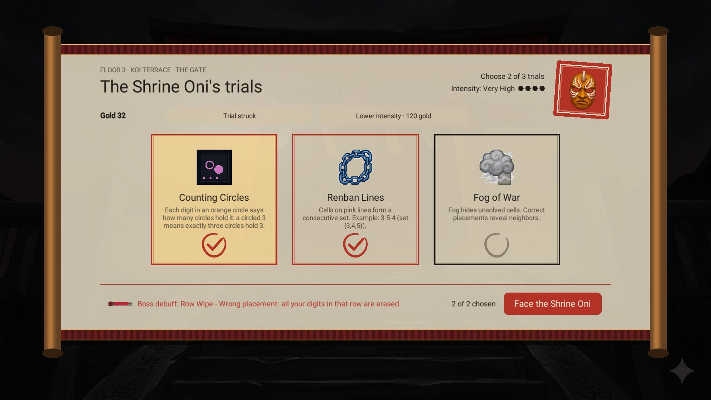
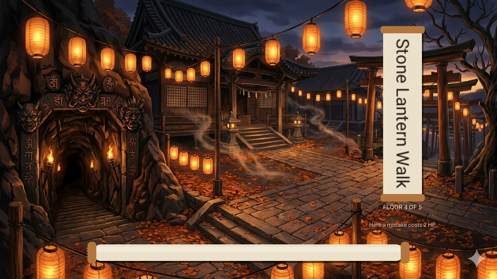
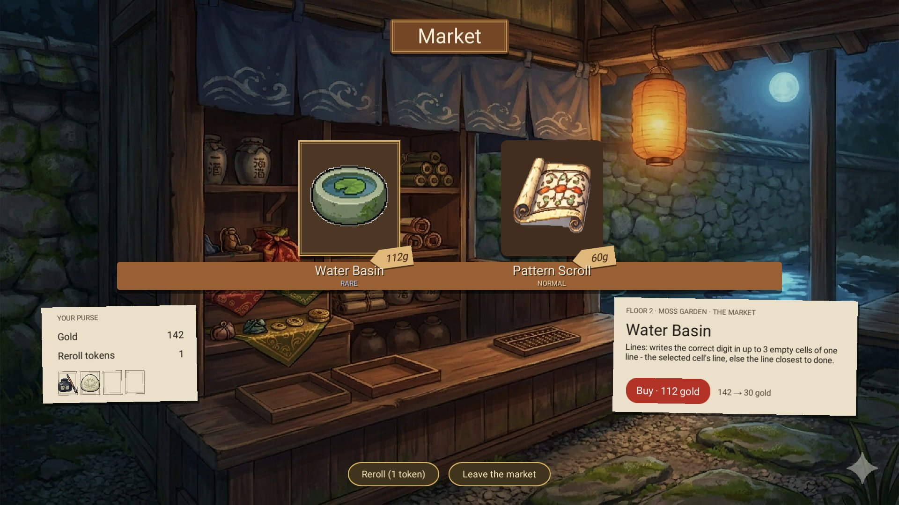

# Concept: make gold and items matter

**Version:** 1.2 | **Date:** 2026-10-21 | **Status:** implemented (L1, L2, L3, L5, L6 built; the balance check waits for the next playtest)

### Change History

| Version | Date | Status | Changes |
|---------|------|--------|---------|
| 1.2 | 2026-10-21 | implemented | L3 built: six counter items, one per modifier family, and shops that lean toward the board's counters (ItemsAndRelicsSystem 2.3, ITEM-COUNTER-001..007). |
| 1.1 | 2026-10-21 | review | Owner picks: L1 + L2 + L5 first, L3 as the content follow-up, and L6. Built as GoldEconomySystem 2.2 and GameDesignSpec 1.14: ECON-BAL-001..004, ECON-GATE-001/002, SCORE-GOLD-001. One change to L2: a struck trial also lowers the boss's picks by one (the gate always offers one trial more than the boss takes, so removing an offer alone would buy nothing). Screenshots below. |
| 1.0 | 2026-10-20 | new | Owner's 0.2.0 playtest: "it feels like gold and items are not needed". Diagnosis from the current numbers, six levers, a recommended package and how to check it. Roadmap item RM-108. |

## What the playtest showed

Gold piles up and items are optional. In the 0.2.0 playtest the run reached the Floor 2 boss with 212 gold and an item bag that was rarely touched.

## Why, in numbers (the baseline before GoldEconomySystem 2.2)

| | Floor 1 | Floor 3 | Floor 5 |
|---|---:|---:|---:|
| Gold per puzzle (`base × (1 + 0.2 × stars)`) | 36–42 (6×6, 1–2★) | 63–104 (7×7 2★ to 8×8 3★) | 160–200 (9×9, 3–5★) |
| Puzzles per floor on a typical route | 5–6 | 5–6 | 5–6 |
| Gold per floor (puzzles only) | ≈ 250 | ≈ 500 | ≈ 1 000 |
| Item prices (`15 / 30 / 60 × (1 + 0.5 × floor)`) | 15 / 30 / 60 | 30 / 60 / 120 | 45 / 90 / 180 |
| Shop offers | 2 | 3 | 4 |

- **Income outruns every sink.** One floor pays for the whole shop several times over. Pencil (+3 for 20 g, +20 each time), the emergency heal (25 g, rising) and rerolls (shop 15 g +5 each, reward 20 g +20 each) are small next to that.
- **Nothing forces a purchase.** HP (7–14 by class) absorbs a floor's mistakes at Harmony 0–3 (1 HP each), the rest node heals a third, and Pencil refills.
- **Items solve problems the player rarely has.** Most items help a little with any puzzle ("restore 3 HP", "+4 pencil"); few answer the rule that is actually hard on this board. With two bag slots and no pressure, keeping them "for later" is the safe play.
- **Gold has no value at the end.** Unspent gold neither scores nor carries over, so there is no reason to save either; it simply does not matter.

## Levers

| # | Lever | Effect on play | Cost |
|---|---|---|---|
| L1 | **Rebalance prices against income.** Item prices ×2.5 (Normal 40, Rare 75, Epic 150, still × floor) and puzzle gold −20 %. Target: one shop visit uses most of a floor's gold. | Every purchase is a choice; the reroll and the heal compete with items. | S: two constants, a balance test |
| L2 | **Gold at the boss gate.** Pay to strike one offered trial (60 g × floor) or to lower the intensity one step (40 g × floor). | Gold becomes the way to shape the hardest puzzle of the floor; saving has a goal. | M: gate UI, BossService hooks |
| L3 | **Counter items.** Each modifier family gets one or two items that answer it (fog already has the Lantern of Clarity; new ones for example: lines, an Ink Brush that fills one cell of a line; cages, an Abacus that lists one cage's possible combinations). Shops lean toward items that counter the floor's rules and, after the gate, the boss's. | Items feel made for the moment; the shop reads the board ahead. | M–L: 6–10 items, texts, icons, shop weighting |
| L4 | **Things worth saving for.** Once per run: +1 bag slot (150 g). Once per floor at the rest: +1 max HP for 80 g instead of a bowl. A relic offer in every second shop (120 g+). | Long-term goals that make "skip this item" a real choice. | M |
| L5 | **Gold counts at the end.** Unspent gold adds to the run score (+1 point per 5 gold, capped at +15 %); shown as its own ledger row. | Spending now versus scoring later; the end screen explains it. | S: one ledger row (RunScoreBreakdown) |
| L6 | **Pressure items relieve.** From Floor 4 a mistake costs 2 HP (Harmony 0–3 included); the rest heals a quarter instead of a third. | Healing and shield items become survival tools late in a run. | S, but it changes difficulty for everyone; playtest first |

## Recommended package

**L1 + L2 + L5 first, L3 as the content follow-up.** L1 makes gold scarce, L2 and L5 give it two clear uses (shape the boss, or bank it for the score), and none of them adds new content. L3 then makes items exciting rather than just affordable. L6 only if runs are still too safe after L1.

Example, Floor 3 with the package: ≈ 400 gold from puzzles (500 − 20 %); a Rare counter item costs 150 (75 × 2), striking a boss trial costs 180 (60 × floor 3), and every 5 gold left at the end adds a point. The player can do two of the three: buy and strike, buy and save, or strike and save.

## How to know it works

- Average gold left at the end of a won run: today several hundred, target under 80.
- Share of shop visits that end with a purchase: target at least 70 %.
- Items used per run: target at least 4.
- A balance test in EditMode (seeded runs, scripted shopping) reports these numbers before and after; the owner's playtests confirm the feel.

## Decisions (2026-10-20) and what is built

The owner picked **L1 + L2 + L5 first, L3 as the content follow-up, and L6**.

| Lever | Built as | Requirement |
|---|---|---|
| L1 | Item base prices 40 / 75 / 150 (× floor as before); puzzle gold × 0.8 | ECON-BAL-001, ECON-BAL-002 |
| L2 | At the boss gate: "Strike a trial" (60 × floor number, then click the trial; the boss takes one trial fewer) and "Lower intensity" (40 × floor number, one step), each once per gate, kept in the save | ECON-GATE-001, ECON-GATE-002 |
| L5 | "Gold kept" row on the run-end ledger: a point per 5 gold, at most 15 % | SCORE-GOLD-001 |
| L6 | From Floor 4 a mistake costs at least 2 HP (the floor's entry painting says so); the rest heals a quarter | ECON-BAL-003, ECON-BAL-004 |
| L3 | Six counter items, one per family (Water Basin: lines, Twin Pebbles: dots and pairs, Rice Bowl: cages and arrows, Moss Stone: cells, Compass of Order: the whole board, Sun Medallion: outside clues), each writing correct digits into its family's cells; shops offer the board's counters at 50 % per slot | ITEM-COUNTER-001..007 |

The gate with its purse and gold actions, after a strike, the Floor 4 entry and the market with the new prices:

L3: on a floor with lines and cages the market offers their counters (here the Water Basin):

The balance check (average gold left, purchases per shop visit, items used per run) waits for the next playtest.
