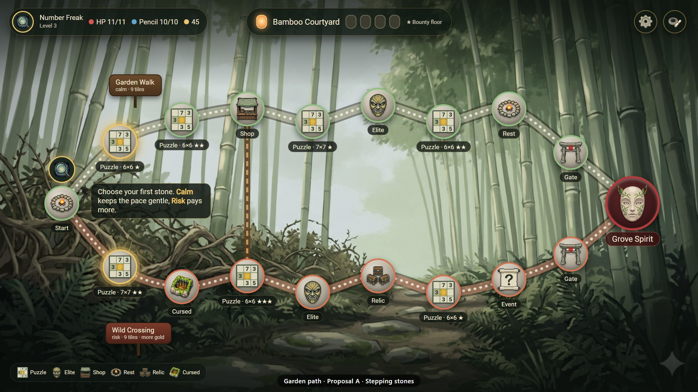
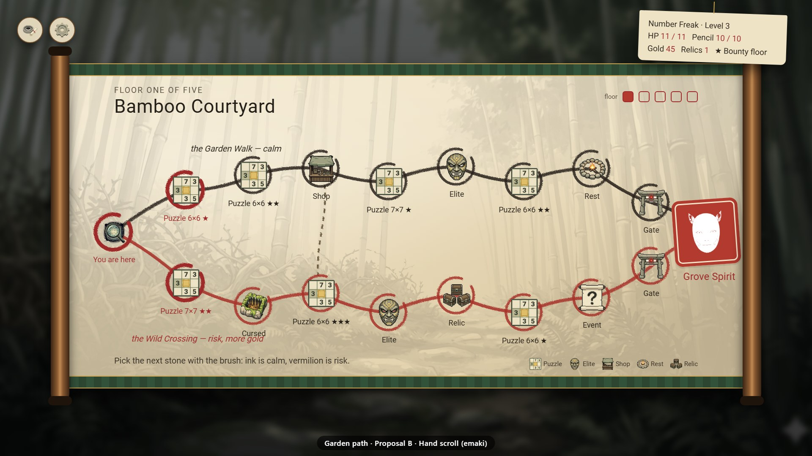
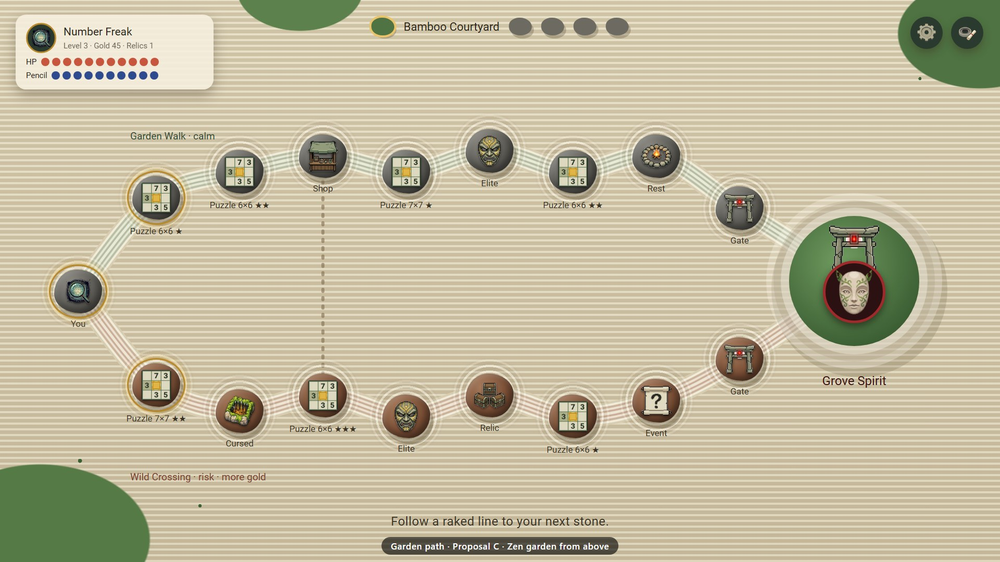
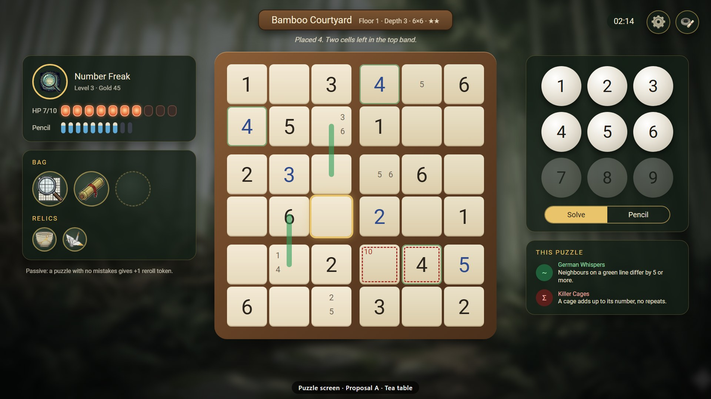
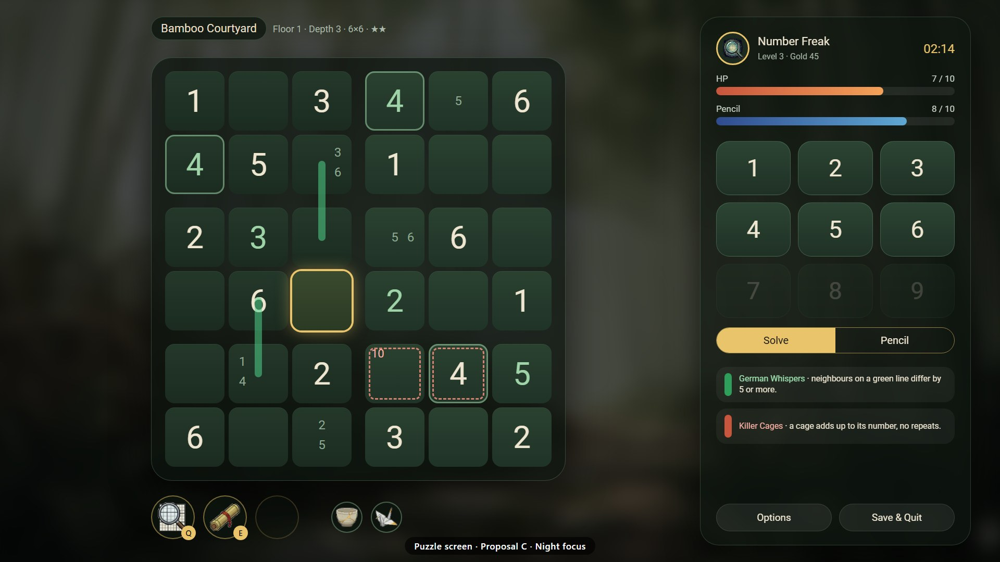

# Layout proposals: garden path and puzzle screen

**Version:** 1.0 | **Date:** 2026-10-15 | **Status:** new (proposals for the owner's choice; nothing is built yet)

### Change History

| Version | Date | Status | Changes |
|---------|------|--------|---------|
| 1.0 | 2026-10-15 | new | Owner request: the garden path and the puzzle layout should feel more rounded and closer to the game's theme. Three proposals each, as 1920×1080 mockups made from the game's own art and font. |

The mockups are HTML pages in `layout-proposals/src/`, built from `Assets/Resources` (backgrounds, node, class, item and relic icons, `MainFont.ttf`) with the same Floor 1 data: two routes of nine tiles, one bridge, the Grove Spirit, and a valid 6×6 puzzle with givens, player digits, pencil marks, a killer cage and German-whisper lines. `layout-proposals/render.ps1` renders them with headless Chrome. The "before" images come from the game itself (`LayoutScreenshotDiagnostics`, an `[Explicit]` PlayMode test).

## Before

| Garden path | Puzzle |
|---|---|
|  |  |

What reads as unfinished today: on the path, translucent squares with unreadable labels, two dark header bars and thin lines sit on top of a beautiful scene, and the legend takes a full bottom row. On the puzzle screen, hard-edged grey panels with large empty areas frame the board, the header box is mostly empty, and bag and relics look like placeholders.

## Garden path

### A · Stepping stones (recommended)



The floor's painting stays the hero. Routes become winding gravel paths (calm in moss green, risk in ember), nodes are round stepping stones with the existing icons and readable labels, the reachable stones glow gold, and the class token stands on the current stone. Route names hang on wooden signs, floors are five lanterns at the top, and the HUD shrinks to floating rounded panels.

- **For:** keeps every background as it is; clearest reading of the two routes; least new art (a stone disc, a ring, a wooden sign).
- **Against:** busy floor paintings need the shading at top and bottom; very long routes need the curve tuned per floor.
- **In Unity:** a circular node sprite with a coloured ring, a curved path `Graphic` (Catmull-Rom spline with a dotted gravel texture) instead of straight lines, 9-slice rounded panels for the HUD.

### B · Hand scroll (emaki)



The floor is painted in ink on a paper hand scroll between two wooden rollers: ink brush lines for the calm route, vermilion for the risk route, an ensō ring around each node, and the boss as a red seal stamp. Stats hang on a paper tag.

- **For:** the strongest identity; floors can feel like chapters of one scroll, and the five floors fit the motif.
- **Against:** hides most of the floor paintings (they only show as a faint wash); needs scroll, brush-stroke and seal art.
- **In Unity:** a scroll frame sprite, brush-stroke textures on the path `Graphic`, a seal sprite; the background is darkened and blurred.

### C · Zen garden from above (karesansui)



The path is seen from above as raked sand: routes are raked grooves, nodes are rocks with raked rings around them (rust-coloured on the risk route), and the boss waits on a moss island with its gate. HP and Pencil are pip rows on a paper card.

- **For:** calm and very readable; the only light screen in the game, which makes the path feel like a breather between puzzles.
- **Against:** loses the floor paintings entirely, so the five floors look alike unless each gets its own sand and moss colours; light background needs dark text everywhere.
- **In Unity:** tiled sand texture, a ring sprite under each node, rock sprites per node type.

## Puzzle screen

All three keep today's information: class, level, gold, HP, pencil, bag, relics, passive, floor/depth/size/stars, status line, timer, number pad, Solve/Pencil, modifier rules, Options, Save & Quit.

**Regions:** proposals A and C separate the boxes with wider gaps. That only works for rectangular boxes; irregular regions (5×5, 7×7 and the jigsaw variants) still need drawn borders that follow the region map (GEN-REGION-004). B draws region borders as thick ink lines, which works for every board.

### A · Tea table (recommended)



The board sits on a wooden tray with paper-coloured, rounded cells, over the current floor's painting (blurred), so every floor keeps its mood during puzzles. HP is a row of lanterns, pencil a row of brushes, items and relics are round slots, the number pad is a 3×3 of round stones, and the modifier rules are short cards.

- **For:** the closest match to "rounded and garden-like" while staying familiar; large, high-contrast digits; floor atmosphere carries into the puzzle.
- **Against:** irregular boards need region borders on top of the tile look (see above).
- **In Unity:** a rounded 9-slice cell sprite, a wooden tray frame, round slot and stone sprites; `BoardViewController` gets the box gap for rectangular regions and keeps borders for irregular ones.

### B · Hanging scroll


The board is drawn in ink on a hanging scroll; HP and Pencil are two paper lanterns that dim as they empty, items and relics are wooden ema plaques, the number pad is wooden tiles, and the modifier rules are pinned paper slips.

- **For:** works for every board shape (ink region borders); the lanterns make HP readable at a glance; very distinctive.
- **Against:** most new art (lanterns with fill states, ema plaques, scroll); the scroll leaves less room for 9×9 at 1080p unless the margins shrink.
- **In Unity:** scroll and rod sprites, lantern sprites with a fill mask, ema plaque sprite; the grid itself gets simpler (lines instead of tiles).

### C · Night focus



The board is as large as possible on dark moss with a soft glow; everything else lives in one rounded glass column on the right (portrait, HP and pencil bars, number pad, mode, rules, Options and Save & Quit); items and relics are a quick bar under the board with key hints.

- **For:** the most focused and the easiest to build; the largest board, which helps 9×9 and controller play.
- **Against:** the least garden-specific: the theme comes from colour only.
- **In Unity:** mostly layout and colour changes in `InRunUiBlueprintBuilder`; rounded 9-slice sprites.

## Recommendation and next step

Path **A** with puzzle **A** keep all the existing art, read best, and need the least new sprites; B is the choice if the game should lean into a strong ink-and-paper identity. Pick one per screen (or mix, for example path A with puzzle B), and I write the requirement IDs into `GameDesignSpec.md`, then build it behind the current layout with screenshots and tests.

## Found while making these

Every background in `Assets/Resources/background/` (all 39) has the same four-point sparkle in its bottom-right corner, the visible watermark of Google's Gemini image generator. It shows in the game (both "before" images) and in anything captured from it. Options: regenerate the backgrounds without the visible mark, cover the corner with UI (as the proposals happen to do), or keep it. Whether removing the mark is allowed depends on the generator's terms, so this is the owner's call.

## Rendering

```powershell
docs/design/layout-proposals/render.ps1            # all mockups -> <name>.png (1920x1080)
docs/design/layout-proposals/render.ps1 -Only "path_a*"
```

The committed images are JPG copies; the PNGs are not committed.
