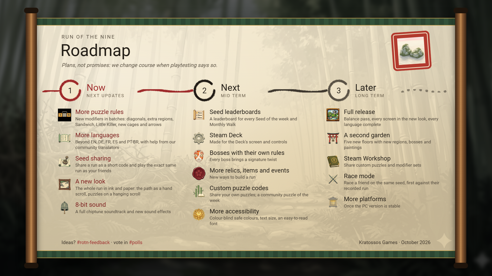

# Roadmap

Plans, not promises: we change course when playtesting says so.

**Run of the Nine**
**Now: the next updates**
• More puzzle rules: new modifiers in batches (diagonals, extra regions, Sandwich, Little Killer, new cages and arrows)
• More languages, with help from our community translators
• Seed sharing: share a run as a short code and play the exact same run as your friends
• A new look for the whole run in ink and paper, and a full 8-bit soundtrack with new sound effects

**Next: mid term**
• Leaderboards for every Seed of the week and Monthly Walk
• Steam Deck support
• Bosses with their own signature rules
• More relics, items and events
• Custom puzzle codes and a community puzzle of the week
• More accessibility options

**Later: long term**
• The full release
• A second garden with five new floors
• Steam Workshop for custom puzzles
• Race mode on a shared seed
• More platforms

---

**Corebound**
• Early Access on Steam: the planned date is on the store page
• Until then: playtests with the Playtester role (pick "Want to help?" in Channels & Roles)

Ideas? #rotn-feedback and #cb-feedback, and vote in #polls.
